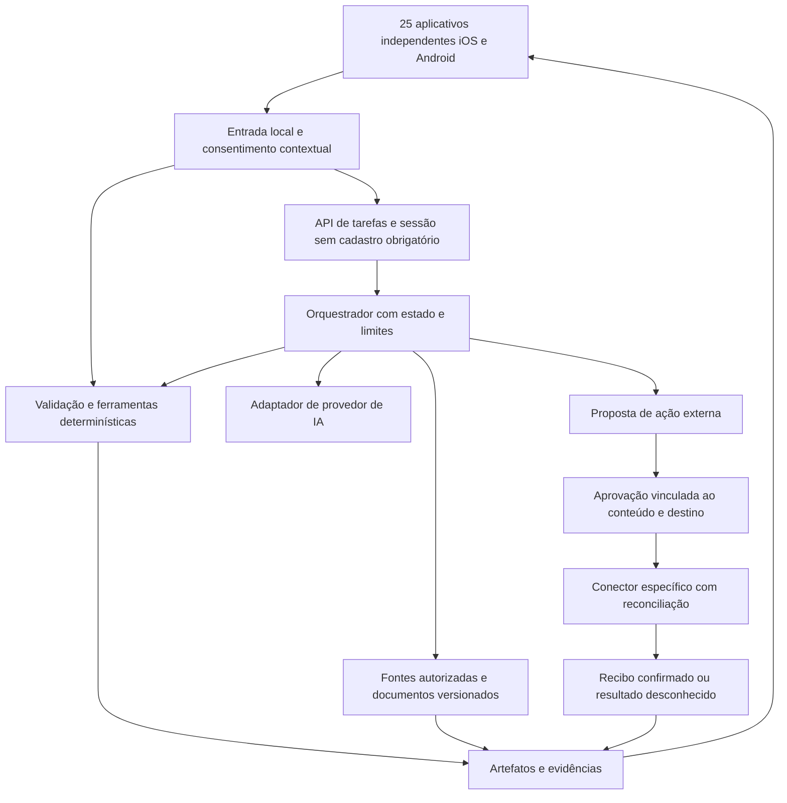

# Plano estrutural dos 25 aplicativos

Este é o plano de execução do projeto, não uma declaração de conclusão. A [diretriz agêntica mais recente](project/PRIORIDADE_AGENTICA.md) prevalece na ordem de trabalho: auditar capacidades reais, conectar fontes/ferramentas e verificar um resultado autêntico por produto antes de contar conclusão. Os nomes e a ordem dos 25 produtos vêm de `apps/apps.json`. O projeto usa uma base técnica compartilhada, mas cada aplicativo mantém sua identidade, seus fluxos, sua distribuição e suas permissões.

A execução segue [cinco lotes de cinco](project/LOTES_DE_EXECUCAO.md), conforme a meta diária solicitada. O [brief oficial da competição](competition/BRIEF_OFICIAL.md) e o [histórico de origem/autoria](competition/ORIGEM_E_AUTORIA.md) orientam a preparação das submissões.

## 1. O que estamos construindo

Vinte e cinco aplicativos independentes de IA para iOS e Android, gratuitos para o usuário, sem anúncios, assinatura, compra interna ou cadastro obrigatório no próprio aplicativo. Autorizações de serviços externos só entram quando uma tarefa concreta precisa delas.

O resultado deve combinar três qualidades verificáveis: utilidade real, autonomia compreensível e interface bem executada. Uma animação, um texto convincente ou uma ferramenta de cálculo isolada não comprova que temos um agente funcional.

**Critério de progresso:** uma entrega precisa acrescentar um artefato inspecionável, um comportamento demonstrável ou a resolução de uma dependência. Relatórios devem dizer quais dados eram fictícios, quais serviços foram simulados e quais operações aconteceram de fato.

## 2. Situação real e níveis de evidência

| Nível | Significado | Prova necessária |
|---|---|---|
| Código de base | Existe implementação de domínio/variante | Arquivos, contrato de entrada e testes locais |
| Unidade de design | Estratégia, fluxos, sistema visual e protótipo foram produzidos | Pacote específico do app; telas e limites inspecionáveis |
| Incremento nativo | Uma parte do aplicativo foi implementada em React Native | Código, testes e bundle; identificar exatamente a parte |
| Fluxo nativo validado | A tarefa principal funciona em iOS e Android | Execução em dispositivos, recuperação, acessibilidade e exportação reais |
| Agente validado | O sistema escolhe/coordena ferramentas para atingir o objetivo, reage a problemas e preserva evidências | Execução observável com ferramentas reais, limites, fontes e recuperação |
| Integração validada | Um serviço específico funcionou com autorização correta | Resultado/recibo confirmado, inclusive teste de falha |
| Publicado | Existe uma distribuição instalável e aceita | Build assinado, distribuição e evidências de aceitação |

Esses níveis não são intercambiáveis. Bundle não é APK/IPA assinado; teste com resposta de modelo controlada não é chamada real ao provedor; referência de arquivo não é documento autenticado; pacote preparado não é envio confirmado. Um aplicativo pode ser agêntico com ações locais ou leitura autorizada: não é obrigatório inventar uma escrita externa para justificar autonomia.

O [registro dos 25 produtos](project/portfolio.json) descreve a situação de cada aplicativo e as evidências conhecidas. `python3 scripts/check_portfolio.py` verifica ordem, identidades, arquivos e declarações de conclusão. Essa checagem valida a consistência do registro; não substitui um teste em dispositivo ou serviço real.

## 3. Estrutura técnica escolhida

Manteremos Expo/React Native com Expo Router para os aplicativos e Python para ferramentas/orquestração. Não há justificativa demonstrada para recomeçar em outra linguagem ou distribuir 25 servidores diferentes. Compartilhar infraestrutura não transforma os 25 produtos em um catálogo único na interface.

O diagrama mistura componentes existentes e componentes planejados; a [arquitetura técnica](project/ARQUITETURA.md) identifica cada um. A sessão de consumidor sem cadastro e os conectores de escrita ainda não estão implementados. Não devemos publicar o servidor de desenvolvimento como se esse desenho de produção já existisse.

Estrutura atual preservada:

| Diretório/componente | Responsabilidade |
|---|---|
| `mobile/` | Interfaces nativas, navegação, estado local, variantes |
| `agents/<id>/` | Especificação e contrato de cada domínio |
| `domain_tools.py` | Cálculos/verificações locais verificáveis |
| `agent_runtime.py`, `advanced.py` | Execução limitada, ferramentas, checkpoints e revisão |
| `storage.py`, `retrieval.py` | Artefatos, eventos, fontes e recuperação |
| `connectors.py` | Leitura autorizada configurada pelo operador; não submissão universal |
| `design/<id>/` | Design, protótipo e relatório de verificação por aplicativo |
| `project/` | Registro, arquitetura, dependências e critérios do programa |
| `scripts/`, `tests/` | Verificação reproduzível |

Separaremos responsabilidades dentro dessa estrutura conforme a necessidade; não moveremos toda a base só para ela parecer mais sofisticada.

## 4. Caminho de execução e critérios de passagem

| Etapa | Entrega | Podemos avançar quando… | Dependência externa |
|---|---|---|---|
| A — Fundação | Inventário, arquitetura, registro, contratos e critérios | Não há contradição entre promessa, código e evidência | Nenhuma para documentação/testes locais |
| B — Design por produto | Três direções avaliadas, escolha, jornadas, 30+ telas justificadas, tokens, estados e protótipo | Cada controle tem comportamento e cada resultado identifica sua origem | Pesquisa com usuários e revisão de domínio para validar hipóteses |
| C — Fluxo nativo principal | Entrada→tarefa→evidência→resultado→revisão/exportação | Funciona com dados normais, vazios, inválidos e após alteração/cancelamento | Dispositivos e ferramentas de build para a aceitação nativa |
| D — Agente limitado | Objetivo, planejamento operacional, ferramentas reais, adaptação e recuperação | Uma tarefa completa e uma falha recuperável foram demonstradas sem sucesso inventado | Provedor se necessário; fontes/autorização específicas |
| E — Integração de domínio | Serviço ou fonte necessária ao caso de uso | Contrato, autorização, atualização, resultado e erro foram verificados | API/parceria/dados permitidos; pode ser inviável em certos portais |
| F — Qualidade e distribuição | Acessibilidade, localização, desempenho, privacidade, assinatura e instalação | Evidências reais em iOS/Android e limites de operação definidos | Contas de desenvolvedor, assinatura, aparelhos e aceite das lojas |

Produziremos as unidades de design na ordem original. Isso não exige esperar todos os 25 designs para testar um fluxo nativo: a infraestrutura e a primeira cadeia funcional são consolidadas enquanto cada produto avança. Para não multiplicar defeitos, uma falha estrutural encontrada no piloto precisa ser corrigida antes de replicar o mecanismo.

A meta de execução é cinco unidades revisáveis por dia, em cinco lotes. Ela não equivale a cinco aplicativos publicados por dia. O prazo exato de inscrição ainda precisa ser confirmado; a página oficial situa a submissão em janeiro de 2027. Os portões de produção dependem de orçamento, aparelhos, fontes e integrações, e serão medidos pelo primeiro fluxo completo.

## 5. Sequência dos 25 produtos e comprovação específica

| # | Produto | Resultado principal a comprovar | Dependência decisiva antes de declarar integração real |
|---|---|---|---|
| 01 | Himayah AI | Revisão de contrato com cada achado ligado ao trecho e à regra | Fontes legais aplicáveis e canal autorizado de revisão |
| 02 | Iqamah AI | Dossiê separando ausência, vencimento e documento não verificado | Critérios oficiais atuais da rota e autoridade correta |
| 03 | Istithmar AI | Comparação reproduzível de implantação com premissas e custos abertos | Taxas e permissões datadas por jurisdição/atividade |
| 04 | Munagasah AI | Adequação ao edital, lacunas e prazo rastreável | Edital, emendas e canal de submissão permitido |
| 05 | Sahil AI | Jornada de serviço público baseada em checklist aplicável | Requisitos atuais do órgão e autorização da operação |
| 06 | Tawteen AI | Reconciliação da força de trabalho com regra e denominador explícitos | Política vigente, exceções e registros de RH autorizados |
| 07 | Adl AI | Cronologia de evidências e valores reivindicados verificáveis | Procedimento aplicável e revisão jurídica para submissões |
| 08 | Tawassul B2B | Proposta localizada a partir de fatos aprovados | CRM/destinatário autorizados e aprovação do contato |
| 09 | Adab AI | Revisão de alegações, canal e contexto cultural | Evidência das alegações e permissão de publicação |
| 10 | Khidmah AI | Resolução do pedido dentro da política e autoridade delegada | Pedido autenticado, política e recibo de eventual reembolso |
| 11 | Jomrok AI | Preparação de remessa com lacunas e evidências por país | Regras atuais, classificação revisada e canal do despachante |
| 12 | Khibrat AI | Evidências de competências contra rubrica aprovada | Rubrica validada e decisão humana de contratação |
| 13 | Majlis AI | Plano de integração baseado em tarefas e manual da empresa | Conteúdo corporativo autorizado e consentimento de compartilhamento |
| 14 | Rafiq | Agenda com conflitos e deslocamentos verificáveis | Calendário autorizado, estimativas de rota e recibo de alteração |
| 15 | Sawm AI | Rotina de trabalho/descanso coerente com preferências fornecidas | Preferências e agenda autorizadas, sem prescrição de saúde |
| 16 | Mizan AI | Gastos e cenários financeiros com cálculo e critérios explícitos | Dados autorizados e revisão especializada quando necessária |
| 17 | Thawg AI | Opções de refeição com disponibilidade e incerteza visíveis | Disponibilidade atual e declarações confiáveis sobre alimentação |
| 18 | Manzil AI | Resumo doméstico de recibos corrigidos e sem duplicidade | OCR revisável e escopo de compartilhamento da família |
| 19 | Gurbah AI | Mudança com dependências e vencimentos rastreáveis | Documentos, serviços e confirmações de reserva autorizados |
| 20 | Amanah Eco | Comparação de consumo com períodos e normalização explícitos | Contas fornecidas e base comparável de medição |
| 21 | Nafas AI | Rotina privada de check-in adaptável às preferências | Tratamento de notas sensíveis e limites do apoio, sem diagnóstico |
| 22 | Tadweer AI | Próximo passo de descarte com regras locais e riscos explícitos | Aceitação atual do material e serviço local de coleta |
| 23 | Turath AI | Jornada de aprendizagem ligada a fontes revisadas | Fontes históricas contextualizadas e controle dos dados do aprendiz |
| 24 | Himam AI | Trajeto com necessidade de acesso e incerteza por segmento | Condição de acessibilidade atual, alternativas e autorização de localização |
| 25 | Hisad AI | Correspondência de lote com validade, alergênicos e custódia | Capacidade real do recebedor e condições verificadas de manuseio |

As definições de tarefa, evidência e aprovação recuperadas do ZIP também estão no registro. Não vamos inventar fontes governamentais, bancos de dados de zonas francas, certificações ou parceiros para preencher essas dependências.

## 6. Autonomia real e controle

Um teste agêntico deve demonstrar: objetivo específico; ferramentas permitidas; seleção/coordenação observável; resultado ligado aos dados; reação a uma informação ausente ou falha; retomada ou encerramento correto; e respeito ao limite de autoridade. Um chatbot que apenas descreve um plano não passa.

Ações reversíveis dentro do escopo escolhido podem ser automáticas. Divulgação de documentos, mensagens, alterações em calendário, pagamento, contratação ou submissão oficial exigem autorização adequada. A aprovação deve identificar o conteúdo, destino e versão. Uma alteração posterior exige revisar a autorização; a resposta do modelo não funciona como recibo de uma operação.

Não precisamos mostrar raciocínio interno. Precisamos mostrar o que começou, o que terminou, as fontes usadas, o que falhou e o que falta. Se o destino não oferece um mecanismo autorizado de integração, o produto pode preparar um pacote para entrega humana; não deve simular autonomia inexistente.

## 7. Ferramentas, contas e custos

**Já disponíveis no projeto:** GitHub para código/histórico; Node/npm/TypeScript/Expo para interfaces; Python e dependências declaradas para ferramentas e grafo; navegador/Playwright para protótipos; SQLite para desenvolvimento e checkpoints. Um protótipo HTML não é o aplicativo final e um teste no navegador não valida o sistema operacional.

**Necessárias conforme a etapa:** provedor de modelo para IA remota; fontes/licenças de dados para cada domínio; infraestrutura com TLS e controle de recursos; aparelhos iOS/Android; ferramentas e contas para assinatura/distribuição. O projeto não exige por definição uma conta de API da OpenAI: a escolha de provedor depende do teste e do contrato. A variável existente `OPENAI_API_KEY` é usada também por um endpoint compatível de outro provedor. Uma assinatura do ChatGPT não substitui automaticamente crédito de API.

**Não necessárias só para começar:** Figma, um segundo backend, novo framework, uma conta emprestada ou uma plataforma adicional. Usaremos uma ferramenta nova apenas se resolver uma limitação concreta que foi demonstrada.

Gratuito para o usuário não significa operação sem custo. O [modelo de orçamento](project/CUSTOS_E_DEPENDENCIAS.md) usa fórmulas e valores a preencher, sem inventar preços atuais ou financiamento. Sem orçamento validado, uso remoto ilimitado não pode ser prometido. Limites transparentes de recursos podem preservar o acesso gratuito; não serão convertidos em assinatura ou paywall.

## 8. Responsabilidades sem transformar você em programador

| Quem | Responsabilidade |
|---|---|
| Assistente | Implementar, revisar arquitetura, executar testes disponíveis, corrigir defeitos, documentar limites e publicar código autorizado |
| Você, como responsável pelo produto | Escolhas de posicionamento que dependem de intenção real; acesso às suas contas quando necessário; orçamento; aparelho/aceite de instalação; dados e decisões de inscrição na competição |
| Serviço/profissional externo quando necessário | Emitir credenciais, autorizar API, validar fontes e questões jurídicas/tributárias/saúde específicas, aprovar distribuição |

Você não deve receber sequências intermináveis de comandos sem validação prévia. Antes de uma etapa que dependa de você, a parte automatizável deve estar pronta e o pedido precisa explicar exatamente o bloqueio e a ação necessária. Credenciais não devem ser coladas no chat nem no GitHub.

## 9. Contrato de entrega e qualidade

Cada atualização relevante terá: problema e comportamento resultante; arquivos e contrato alterados; evidências executadas; dados fictícios/simulações identificados; limitações; próximo critério concreto. A publicação no GitHub será confirmada comparando o commit remoto com o local.

Para cada app: três direções de design, cinco jornadas, no mínimo 30 telas justificadas, tokens claros/escuros, componentes/estados, acessibilidade, adaptação iOS/Android, protótipo conectado, handoff e revisão de qualidade. Não contaremos títulos vazios, páginas de login proibidas ou variações decorativas para atingir 750 telas.

Antes de uma versão instalável: testar a tarefa principal nos dois sistemas, entradas inválidas, fontes ausentes, cancelamento, conexão instável, retomada, autorização, texto ampliado, leitor de tela e artefato final. Desempenho e fluidez devem ser medidos nos aparelhos; uma promessa de “qualidade Apple” não substitui isso.

As etapas imediatas são concluir o primeiro lote (Himayah, Iqamah, Istithmar, Munagasah e Sahil), verificar a infraestrutura compartilhada e seguir os lotes 2–5 na ordem original. Os portões de serviço real/dispositivo continuam explícitos até existirem as dependências e as respectivas provas.
