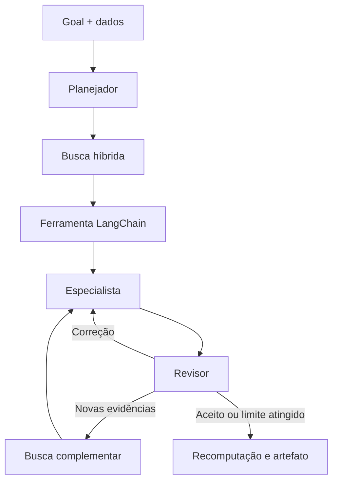

# Arquitetura v4

`advanced.py` define o grafo LangGraph; checkpoints SQLite armazenam o estado entre nós. As ferramentas são fechadas por agente e execução em `langchain_tools.py`. O modelo não pode substituir os dados de entrada da ferramenta. A ferramenta de domínio não é reexecutada nas revisões; apenas a verificação final a recomputa.

`retrieval.py` mantém vetores por agente, documento, trecho e modelo. O ranking lexical vem do FTS5; o semântico usa cosseno; a fusão usa a soma de `1/(60+posição)`. O modelo de embeddings é explicitamente escolhido pelo operador. Textos e consultas só saem para o provedor quando a função correspondente é utilizada.

`agent_runtime.py` fornece fila local, exclusão mútua por execução e lease de worker. `storage.py` persiste tarefas, eventos, documentos e memória aceita. A base mantém compatibilidade com a versão 2: o novo índice é criado sob demanda e o checkpoint tem arquivo próprio.

`exports.py` oferece adaptadores locais tipados, com MIME, nome, bytes e hash. Não registra uma transação externa. A extensão para um conector externo precisará implementar autenticação, contrato específico, idempotência no sistema de destino e recibo consultável; escritas externas não existem nesta entrega. O adaptador de leitura HTTPS está em `connectors.py` e exige um endpoint fixo definido pelo operador.

Fontes técnicas usadas:
- https://docs.langchain.com/oss/python/langgraph/persistence
- https://developers.openai.com/api/docs/guides/function-calling
- https://developers.openai.com/api/reference/resources/embeddings/methods/create

Versões do ambiente de teste estão fixadas em `requirements-agentic.txt`. Identidades opcionais usam bancos separados por usuário. A aplicação mantém o contexto com ContextVar e o copia para os workers. `scheduling.py` cria ocorrências e runs na mesma transação. O escopo operacional é uma instância de servidor por diretório, sem coordenação distribuída.

`document_import.py` executa parsers em subprocesso com ambiente reduzido. `intake.py` prepara dados por linguagem natural, mas não dispara tarefas. `identity.py` resolve tokens; `manage.py` provê identidades e backups administrativos.
